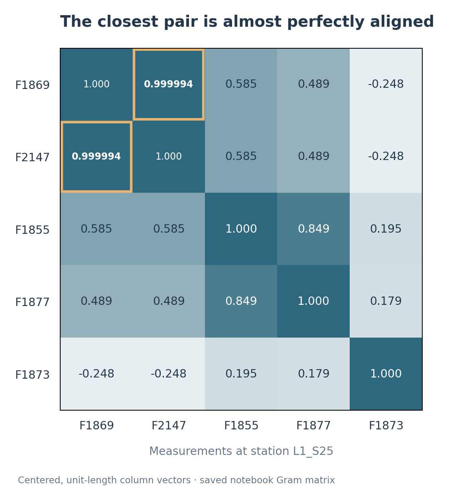
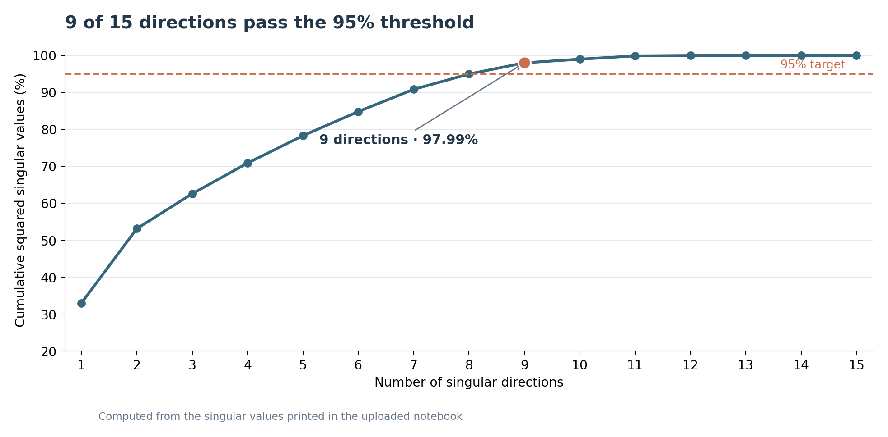
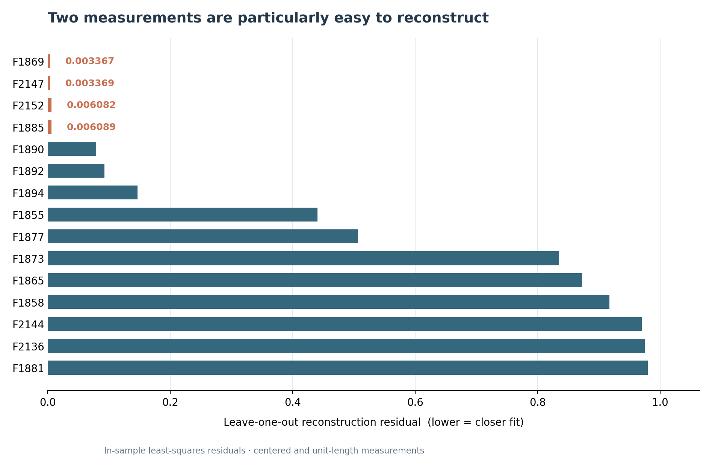

# Measurement redundancy at Bosch station `L1_S25`

This notebook examines whether measurements taken at the same production station carry overlapping linear information. I used 15 columns from station `L1_S25` in the [Bosch Production Line Performance dataset](https://www.kaggle.com/competitions/bosch-production-line-performance/data), then compared their rank, singular values, and how well each column could be reconstructed from the others.

The clearest result is the pair `L1_S25_F1869` and `L1_S25_F2147`. Their correlation is **0.999994** on the selected rows. The measurement matrix still has full column rank, so this is a case of *near* redundancy rather than exact linear dependence.

## Data selection

The notebook reads the first **100,000 rows** of `train_numeric.csv`. There are 968 numeric measurement columns in that slice, of which 284 belong to `L1_S25`.

I selected the **15 columns with the most non-missing entries** at that station and kept only rows where all 15 were recorded. That leaves a **227 × 15** matrix. The selection is based on data availability, not on the physical importance of the measurements.

| Quantity | Result |
|:--|--:|
| Selected measurements | 15 |
| Complete observations | 227 |
| Rank of the original matrix | 15 / 15 |
| Singular directions needed to exceed 95% of squared variation | 9 / 15 |
| Squared variation accounted for by the first 9 directions | 97.99% |
| Smallest reconstruction residual (`F1869`) | 0.003367 |
| Correlation between `F1869` and `F2147` | 0.999994 |

These numbers are taken from the outputs saved in the notebook, not from a separate run with a different sample.

## Analysis

### 1. Rank and column normalization

The original matrix has rank 15, so none of its columns is an exact linear combination of the others under the numerical rank test. Rank alone, however, does not show how *close* columns are to being dependent.

I centered each column and divided it by its Euclidean norm. With **A** denoting the original matrix and **Z** its normalized version:

$$
\displaystyle
\mathbf{Z}_{:,j}
=
\frac{\mathbf{A}_{:,j}-\bar a_j\mathbf{1}}
{\left\lVert\mathbf{A}_{:,j}-\bar a_j\mathbf{1}\right\rVert_2}
$$

This removes differences in offset and scale before comparing patterns across measurements.

### 2. Singular value decomposition

I applied SVD to the centered, normalized matrix:

$$
\displaystyle
\mathbf{Z}=\mathbf{U}\,\boldsymbol{\Sigma}\,\mathbf{V}^{\mathsf T}
$$

The squared singular values describe how the matrix's squared norm is distributed across orthogonal directions. I measured the cumulative share with:

$$
\displaystyle
C(k)=\frac{\sum_{i=1}^{k}\sigma_i^2}{\sum_{i=1}^{15}\sigma_i^2}
$$

The first eight directions account for **94.96%**. Including the ninth raises the total to **97.99%**, which passes the 95% threshold used in the notebook. The last singular values are small, but nonzero.

This is a description of the selected matrix after normalization. It does not mean that nine physical sensors could replace fifteen.

### 3. Reconstructing one measurement from the others

To identify individual columns with little unique linear information, I excluded one normalized column at a time and fitted it from the other 14 using least squares:

$$
\displaystyle
\widehat{\boldsymbol{\beta}}_j
=\operatorname*{arg\,min}_{\boldsymbol{\beta}}
\left\lVert\mathbf{z}_j-\mathbf{Z}_{-j}\boldsymbol{\beta}\right\rVert_2
$$

The reconstruction residual is:

$$
\displaystyle
r_j=\left\lVert
\mathbf{z}_j-\mathbf{Z}_{-j}\widehat{\boldsymbol{\beta}}_j
\right\rVert_2
$$

`F1869` has the smallest residual (**0.003367**), followed by `F2147` (**0.003369**). Both can be approximated very closely by the other measurements *on the same observations used to fit the coefficients*.

### 4. Pairwise similarity

A low reconstruction residual does not necessarily mean that one other column is almost identical; the reconstruction could use several columns together. I therefore checked dot products between the centered, unit-length columns:

$$
\displaystyle
\mathbf{G}=\mathbf{Z}^{\mathsf T}\mathbf{Z},
\qquad G_{ij}=\mathbf{z}_i^{\mathsf T}\mathbf{z}_j
$$

For these normalized columns, the dot product equals the Pearson correlation coefficient. The strongest pair involving `F1869` is `F2147`, at **0.999994**. The heatmap above shows this pair alongside four other measurements from the notebook's smaller comparison group.

## Interpretation and limitations

The main finding is fairly specific: **two selected columns move almost identically across the 227 complete observations**, and several columns can be reconstructed with very small in-sample errors. Their small residuals are consistent with substantial linear overlap, despite the matrix being full rank.

There are important limits to that conclusion. Bosch anonymizes the feature names, so these columns cannot be identified as particular physical sensors. The analysis covers one station, the first 100,000 rows loaded from the dataset, and only 227 complete rows after filtering. The reconstruction errors were measured on the fitting data; they are **not** out-of-sample validation errors. I also did not use the `Response` label or assess any effect on fault detection.

In other words, this is a numerical redundancy check, not a recommendation to remove hardware or measurements from a production line.

## Reproducing the notebook

- **Notebook:** [`Bosch_Measurement_Redundancy.ipynb`](Bosch_Measurement_Redundancy.ipynb)
- **Data:** [Bosch Production Line Performance — Kaggle](https://www.kaggle.com/competitions/bosch-production-line-performance/data), `train_numeric.csv` from `train_numeric.csv.zip`
- **Environment:** Python with NumPy and pandas; the notebook's file path assumes Google Colab

Place `train_numeric.csv` at `/content/train_numeric.csv` and run the notebook from the first cell. The CSV itself is not included here. The three figures in this README were prepared from the numerical outputs already saved in the notebook.
